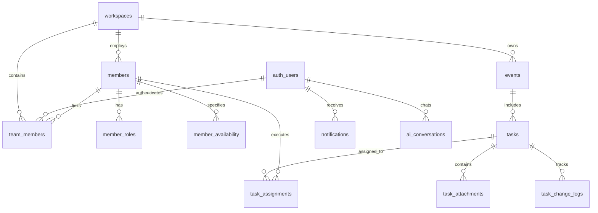
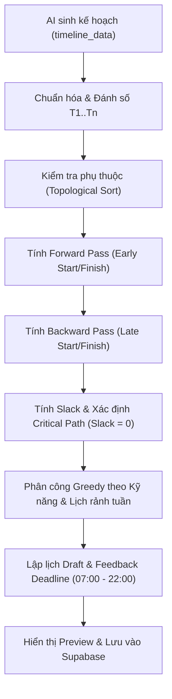

# BÁO CÁO TOÀN DIỆN HỆ THỐNG AECPT (TASK TRACKER)
> **Tài liệu chuẩn hóa kiến trúc, cơ sở dữ liệu, nghiệp vụ & hướng dẫn vận hành cho AI và kỹ sư phần mềm**  
> **Dự án:** AI Event Comm-plan Tracker (AECPT / Multimedia Task Tracker)  
> **Cập nhật:** 16/11/2026 | **Phiên bản:** 2.4.0  
> **Kho mã nguồn:** [GitHub Repository (Test-web-AI)](https://github.com/NguyenBaHuy0610/Test-web-AI) | Branch: `main`

---

## 1. TỔNG QUAN HỆ THỐNG (SYSTEM OVERVIEW)

### 1.1. Mục đích & Phạm vi
**AECPT (AI Event Comm-plan Tracker)** là nền tảng quản lý dự án truyền thông và sự kiện chuyên biệt dành cho ban Multimedia. Hệ thống kết hợp giữa:
1. **Quản trị đa không gian làm việc (Multi-tenant Workspaces)**: Mỗi người dùng tự đăng ký sẽ làm Trưởng nhóm (Leader) sở hữu một không gian làm việc độc lập; thành viên (Member) chỉ được thêm trực tiếp bởi Leader.
2. **Quản lý sự kiện đơn nhiệm (Single Active Event Rule)**: Tại mỗi thời điểm, một Workspace chỉ được có **tối đa 1 sự kiện đang diễn ra (`status = 'active'`)** nhằm tối ưu hóa sự tập trung của đội ngũ.
3. **Trợ lý AI lập kế hoạch siêu tốc (AI Timeline Assistant)**: Ứng dụng mô hình ngôn ngữ lớn (Groq LLMs & Gemini Backup) đọc tài liệu (PDF, Word, Excel, hình ảnh), phân tích brief, tự động gợi ý các gói công việc dạng bảng Markdown, và xuất dữ liệu `timeline_data`.
4. **Thuật toán lập lịch đường găng (CPM - Critical Path Method Engine)**: Tự động tính toán Early Start (ES), Late Finish (LF), thời gian dự trữ (Slack), xác định đường găng (Critical Path) và phân công nhân sự tối ưu dựa trên kỹ năng chuyên môn và khung giờ rảnh hàng tuần.

### 1.2. Công nghệ cốt lõi (Technology Stack)
- **Frontend**: Vanilla HTML5, CSS3 hiện đại (CSS Variables, Flexbox, Grid, hỗ trợ Light/Dark mode), JavaScript ES6+ (Không dùng framework nặng như React/Vue để tối ưu tốc độ tải trang và tính tương thích). Thư viện phụ trợ: `Lucide Icons`, `FullCalendar`, `Mammoth.js` (Word), `PDF.js` (PDF), `SheetJS/XLSX` (Excel).
- **Backend & Database**: [Supabase](https://supabase.com) (PostgreSQL 15+, Supabase Auth, Row Level Security - RLS, Database Triggers, PL/pgSQL Stored Procedures, Deno Edge Functions, Supabase Storage & Realtime).
- **Local Proxy & Dev Server**: Node.js HTTP Server (`server/server.js`) chạy cổng `3000`, tự động tải biến môi trường `.env`, cung cấp endpoint ảo `/config.js`, hỗ trợ chuyển cổng tự động nếu bị chiếm dụng.
- **AI Engine**: 
  - **Chính (Primary)**: **Groq API** (Tốc độ suy luận siêu tốc ~500-1000 tokens/s) với các mô hình: `qwen/qwen3.8-27b` (hỗ trợ Vision multimodal), `openai/gpt-oss-120b`, `openai/gpt-oss-20b`.
  - **Dự phòng (Fallback)**: **Google Gemini API** (`gemini-2.5-flash`) tự động kích hoạt khi Groq hết quota hoặc lỗi kết nối.
  - **AI Chăm sóc nội bộ (Bảo mẫu AECPT)**: Mô hình hỗ trợ người dùng theo dõi tiến độ, kiểm tra deadline và cảnh báo task trễ hạn.

---

## 2. KIẾN TRÚC THƯ MỤC VÀ CÁC THÀNH PHẦN MÃ NGUỒN

```
task_tracker-main/
├── .env                            # Chứa API Keys bí mật (Groq, Gemini, Port)
├── .env.example                    # Mẫu cấu hình môi trường chuẩn
├── package.json                    # Khai báo script start & thư viện parser tệp
├── README.md                       # Tài liệu hướng dẫn cài đặt nhanh
├── algorithm/                      # Thuật toán lập kế hoạch Python & bản Web demo
│   ├── demo.py                     # Demo CLI thuật toán lập lịch
│   ├── task-planner-demo.html      # Demo trực quan hóa thuật toán bằng JS
│   └── taskplanner/                # Module Python xử lý CPM, phân công, xung đột
├── frontend/                       # Toàn bộ giao diện người dùng
│   ├── index.html                  # Trang điều hướng gốc / kiểm tra phiên đăng nhập
│   ├── components/                 # Các component dùng chung
│   │   └── sidebar.html            # Thanh điều hướng bên trái (Sidebar, Thông báo)
│   ├── pages/                      # Các màn hình chính của ứng dụng
│   │   ├── login.html              # Đăng nhập, Đăng ký (mặc định Leader), Quên mật khẩu
│   │   ├── dashboard.html          # Bảng điều khiển, Chatbot AI lập Timeline, Thẻ sự kiện
│   │   ├── tasks.html              # Quản lý danh sách công việc (Kanban, List, Bộ lọc)
│   │   ├── members.html            # Danh sách thành viên, Lịch rảnh tuần, Thêm thành viên
│   │   ├── calendar.html           # Xem lịch công việc & deadline theo tháng/tuần
│   │   ├── setting.html            # Cấu hình cá nhân, Giao diện Sáng/Tối, Khóa API
│   │   └── reset-password.html     # Khôi phục mật khẩu qua liên kết email
│   ├── js/                         # Logic JavaScript phía Client
│   │   ├── sidebar.js              # Quản lý thanh điều hướng, loadAppUser, thông báo, theme
│   │   ├── dashboard.js            # Controller Dashboard, Chat AI, Markdown Table, Tạo sự kiện
│   │   ├── tasks.js                # Quản lý Task, Modal chỉnh sửa, Đổi trạng thái
│   │   ├── members.js              # Quản lý nhân sự, Lịch rảnh tuần, Gọi Edge Function tạo Member
│   │   ├── calendar.js             # Hiển thị lịch công việc
│   │   ├── login.js                # Xử lý xác thực Auth, kiểm tra lỗi OTP URL expired
│   │   ├── setting.js              # Lưu thiết lập người dùng
│   │   ├── groq.js                 # Dịch vụ Groq AI, Anti-hallucination, Prompt bảng gói
│   │   ├── gemini.js               # Dịch vụ Gemini Backup AI
│   │   ├── timeline-engine.js      # Thuật toán CPM, gán task T1..Tn, đồng bộ Supabase
│   │   ├── support-widget.js       # Widget AI hỗ trợ nổi góc màn hình
│   │   ├── theme.js                # Chuyển đổi theme Light / Dark
│   │   └── i18n.js                 # Hỗ trợ đa ngôn ngữ (mặc định Tiếng Việt)
│   └── styles/                     # CSS module hóa theo từng trang
│       ├── global.css              # Style dùng chung, biến CSS, Typography
│       ├── sidebar.css             # Style Sidebar, Hộp thông báo, Nút tích đã đọc
│       ├── dashboard.css           # Style Chatbot, Thẻ Timeline, Bảng Markdown (.chat-md-table)
│       ├── tasks.css               # Style danh sách công việc & bộ lọc
│       ├── members.css             # Style bảng thành viên & lưới lịch rảnh 7 ngày
│       ├── calendar.css            # Style trang lịch
│       └── login.css               # Style màn hình đăng nhập / đăng ký
├── server/
│   └── server.js                   # Node.js static & config server (Port 3000)
└── supabase/
    ├── ai_conversations.sql        # Schema lưu trữ lịch sử hội thoại AI
    ├── notifications.sql           # Schema bảng thông báo & RPC cập nhật đã đọc
    ├── support_chat_tracking.sql   # Schema nhật ký thay đổi công việc & widget AI
    ├── unified_feedback_fixes.sql  # Tổng hợp chính sách RLS & hàm trigger
    ├── workspaces.sql              # Schema Không gian làm việc đa người dùng
    ├── functions/
    │   └── create-workspace-member/# Deno Edge Function cho Leader tạo thành viên
    └── migrations/                 # Các file migration chuẩn Supabase CLI
        ├── 20261114220000_notifications_update_own.sql
        ├── 20261115140000_events_select_workspace.sql
        ├── 20261115142500_members_update_workspace.sql
        ├── 20261115143500_team_members_select_workspace.sql
        ├── 20261115144000_workspace_tasks_read.sql
        ├── 20261115204200_remove_workspace_member.sql
        ├── 20261115204900_protect_workspace_leaders.sql
        ├── 20261115220500_standardize_roles_and_task_assignments.sql
        └── 20261116000000_self_signup_default_leader.sql
```

---

## 3. CƠ SỞ DỮ LIỆU & BẢO MẬT HÀNG (DATABASE SCHEMA & RLS)



### 3.1. Các bảng chính (Tables Specification)
1. **`workspaces`**: Không gian làm việc độc lập.
   - `workspace_id` (TEXT, PK): Mã dạng `WS_01`, `WS_02`, sinh tự động qua sequence `workspace_seq`.
   - `workspace_name` (TEXT): Tên workspace (ví dụ: `Workspace của Nguyễn Bá Huy`).
   - `created_by` (UUID, FK -> `auth.users.id`): ID người tạo (Leader sở hữu).
2. **`team_members`**: Cầu nối phân quyền giữa tài khoản đăng nhập và hồ sơ thành viên trong workspace.
   - `user_id` (UUID, FK -> `auth.users.id`, UNIQUE): 1 tài khoản Supabase Auth thuộc 1 workspace tại một thời điểm.
   - `member_id` (TEXT, PK, FK -> `members.member_id`): Mã hồ sơ nhân sự.
   - `account_role` (TEXT): Quyền hệ thống, nhận một trong hai giá trị: `'leader'` (Trưởng nhóm) hoặc `'member'` (Thành viên).
   - `workspace_id` (TEXT, FK -> `workspaces.workspace_id`): Không gian làm việc trực thuộc.
3. **`members`**: Hồ sơ nhân sự trong ban truyền thông.
   - `member_id` (TEXT, PK): Sinh tự động dạng `MEM_...` qua hàm `aecpt_gen_id('MEM_')`.
   - `member_label` (TEXT): Tên hiển thị (Họ và tên).
   - `email` (TEXT, UNIQUE): Email liên hệ (có ràng buộc unique không phân biệt hoa thường `uq_members_email`).
   - `workspace_id` (TEXT, FK): Workspace sở hữu hồ sơ.
   - `is_active` (BOOLEAN): Trạng thái hoạt động (mặc định `true`).
4. **`member_roles`**: Nhóm chức năng chuyên môn của từng thành viên.
   - Cột: `member_id`, `role` (`'content'`, `'design'`, `'photo'`, `'video'`, `'technician'`), `in_roster` (BOOLEAN).
5. **`member_availability`**: Lịch rảnh hàng tuần theo khung giờ.
   - Cột: `availability_id` (UUID), `member_id`, `weekday` (INTEGER 2..8 tương ứng Thứ Hai .. Chủ Nhật), `start_time` (TIME), `end_time` (TIME).
6. **`events`**: Sự kiện / Chiến dịch truyền thông.
   - `event_id` (TEXT, PK): Dạng `EV_01`, `EV_02`...
   - `workspace_id` (TEXT, FK): Workspace sở hữu sự kiện.
   - `event_label` (TEXT): Tên sự kiện (ví dụ: *Workshop làm đồ chơi*).
   - `status` (TEXT): `'active'` (Đang diễn ra), `'draft'` (Bản nháp), `'finished'` (Đã kết thúc).
   - `is_completed` (BOOLEAN): Đánh dấu đã hoàn thành.
7. **`tasks`**: Danh sách công việc thuộc sự kiện.
   - `task_id` (TEXT, PK): Đánh số chuẩn dạng `T1`, `T2`, `T3`...
   - `workspace_id` (TEXT, FK), `event_id` (TEXT, FK).
   - `task_label` (TEXT): Tên công việc.
   - `task_type` (TEXT): `'product'` (Sản phẩm), `'onpage'` (Bài đăng), `'onsite'` (Tại hiện trường).
   - `status` (TEXT): `'todo'`, `'in_progress'`, `'review'`, `'done'`.
   - `duration_hours` (NUMERIC): Thời lượng thực hiện ước tính (giờ).
   - `complexity` (INTEGER): Độ phức tạp (1: Dễ, 2: Trung bình, 3: Phức tạp).
   - `depends_on` (TEXT[]): Mảng các mã task phụ thuộc (ví dụ `["T1"]`).
   - `deadline` (TIMESTAMPTZ): Hạn nộp bản nháp (Draft deadline).
   - `feedback_due` (TIMESTAMPTZ): Hạn chót duyệt / sửa bài.
   - `on_air` (TIMESTAMPTZ): Thời điểm công bố / đăng tải / diễn ra.
   - `is_critical` (BOOLEAN): Nằm trên đường găng (Critical Path).
   - `slack_hours` (INTEGER): Thời gian dự trữ an toàn.
8. **`task_assignments`**: Phân công người phụ trách công việc.
   - `assignment_id` (UUID, PK), `task_id`, `member_id`, `role_in_task` (`'primary'` hoặc `'backup'`).
9. **`notifications`**: Thông báo hệ thống và cảnh báo hạn chót.
   - Cột: `notification_id`, `user_id`, `title`, `content`, `type`, `is_read`, `read_at`, `created_at`.
10. **`ai_conversations`**: Lịch sử đoạn chat với AI của từng người dùng.

### 3.2. Cơ chế phân quyền RLS (Row Level Security)
Toàn bộ các bảng đều được bật RLS (`ENABLE ROW LEVEL SECURITY`) với các quy tắc bảo mật cốt lõi:
- **`public.my_workspace_id()`**: Trả về `workspace_id` của tài khoản hiện tại từ bảng `team_members`. Người dùng tuyệt đối không thể đọc hay can thiệp vào dữ liệu của workspace khác.
- **`public.is_leader()`**: Kiểm tra tài khoản có quyền `leader` trong workspace hay không.
- **`public.can_read_event(p_event_id)`**:
  - Người dùng chỉ thấy sự kiện thuộc workspace của mình.
  - **Quy tắc sự kiện duy nhất**: Nếu workspace có sự kiện `status = 'active'`, toàn bộ thành viên và leader CHỈ NHÌN THẤY sự kiện active này. Nếu không có sự kiện active, thành viên thấy các sự kiện đã kết thúc, riêng Leader thấy thêm các sự kiện bản nháp (`draft`).
- **Quyền tạo / xóa sự kiện**: Chỉ Leader mới có quyền tạo sự kiện mới hoặc xóa sự kiện.
- **Quyền sửa hồ sơ thành viên**: Thành viên chỉ được sửa Tên hiển thị và Nhóm chuyên môn của chính mình; Leader có quyền chỉnh sửa toàn bộ thành viên trong workspace.

### 3.3. Cơ chế tự động cấp quyền khi đăng ký (Auto-Provisioning)
- **Hàm `aecpt_provision_user(p_user_id)`**:
  - Khi một tài khoản mới tự đăng ký qua trang [login.html](file:///c:/Users/bahoa/Downloads/task_tracker-main/task_tracker-main/frontend/pages/login.html), hệ thống tự động:
    1. Tạo 1 Workspace mới: `Workspace của <Tên người dùng>` với ID tự sinh (ví dụ `WS_04`).
    2. Kiểm tra nếu email đã từng tồn tại trong bảng `members`: Tự động chuyển hồ sơ đó sang Workspace mới để không bao giờ vi phạm ràng buộc `uq_members_email`.
    3. Thêm một dòng vào `team_members` với `account_role = 'leader'`.
- **Hàm RPC `ensure_my_workspace()`**:
  - Hàm `SECURITY DEFINER` cho phép Client tự động phục hồi và cấp ngay Workspace + quyền Leader nếu phiên đăng nhập chưa có `team_members`.
- **Tài khoản Thành viên (`member`)**:
  - Không tự đăng ký tự do ngoài màn hình chính. Leader sẽ vào trang [members.html](file:///c:/Users/bahoa/Downloads/task_tracker-main/task_tracker-main/frontend/pages/members.html) -> Bấm **"Thêm thành viên"** -> Nhập Họ tên, Email, Mật khẩu ban đầu -> Hệ thống gọi Edge Function `create-workspace-member` để tạo sẵn tài khoản Auth và gắn trực tiếp vào Workspace đó với vai trò `member`.

---

## 4. CHI TIẾT NGHIỆP VỤ & QUY TRÌNH FRONTEND (FRONTEND WORKFLOWS)

### 4.1. Màn hình Đăng nhập / Đăng ký (`login.html` & `login.js`)
- **Chế độ đăng nhập**: Kiểm tra `signInWithPassword`. Lưu email vào `localStorage` nếu chọn "Ghi nhớ đăng nhập".
- **Chế độ đăng ký**: Gọi `signUp` với metadata `role: 'leader'`. Hiển thị thông báo xác nhận email rõ ràng.
- **Xử lý mã OTP hết hạn (`checkUrlAuthErrors`)**: Bắt các mã băm URL như `#error=access_denied&error_code=otp_expired` khi người dùng nhấn lại link email cũ; cung cấp nút gửi lại email xác thực mới ngay trên màn hình.

### 4.2. Thanh điều hướng & Thông báo (`sidebar.js` & `sidebar.html`)
- Tải động giao diện vào container `#sidebar-container`.
- **`loadAppUser`**: Nạp thông tin tài khoản, tự phục hồi quyền Leader qua `ensure_my_workspace()`, xác định quyền `isLeader`.
- **Trung tâm thông báo (Notification Center)**:
  - Hiển thị danh sách thông báo chưa đọc / đã đọc.
  - Từng thông báo có **nút tích tròn** để đánh dấu đã đọc riêng lẻ.
  - Có nút **"Đánh dấu đã đọc"** toàn bộ ở góc trên.
  - Gọi RPC bảo mật `mark_notification_as_read` và `mark_all_notifications_as_read`.

### 4.3. Bảng điều khiển & Trợ lý Chat AI (`dashboard.html` & `dashboard.js`)
- **Tạo sự kiện mới**:
  - Leader bấm "Tạo sự kiện", kiểm tra hợp lệ: Không được có sự kiện `active` nào khác đang chạy trong cùng workspace.
- **Thẻ sự kiện đang diễn ra (Active Event Card)**:
  - Hiển thị tên sự kiện, tiến độ hoàn thành, nút "Hoàn tất sự kiện" (chỉ Leader mới thấy).
- **Trợ lý AI lập kế hoạch sự kiện**:
  - Tích hợp khung chat tương tác với Groq / Gemini AI.
  - **Trình hiển thị Bảng Markdown (`formatMessage`)**: Mọi bảng công việc dạng Markdown (`| ... |`) do AI xuất ra đều được tự động render thành thẻ `<table>` chuyên nghiệp với lớp CSS `.chat-md-table`, có thanh cuộn ngang chống vỡ khung trên thiết bị di động.
  - **Khối `timeline_data`**: Khi người dùng đồng ý kế hoạch, AI xuất khối JSON ````timeline_data ... ````; giao diện tự động bắt khối này, gọi `TimelineEngine.planTimeline()`, tính toán CPM, và vẽ Thẻ xem trước kế hoạch (`.timeline-preview-card`) kèm nút **"Xác nhận & Lưu vào Supabase"**.

### 4.4. Quản lý công việc (`tasks.html` & `tasks.js`)
- Danh sách công việc phân loại theo trạng thái: Cần làm (Todo), Đang làm (In Progress), Chờ duyệt (Review), Hoàn thành (Done).
- Bộ lọc kết hợp: Lọc theo Nhóm chuyên môn (Content, Design, Video, Photo, Tech) và Trạng thái.
- Đánh dấu công việc thuộc **Đường găng (Critical Path)** bằng huy hiệu đỏ nổi bật.
- Hỗ trợ xem hạn nộp nháp (Draft), hạn phản hồi (Feedback) và ngày lên sóng (On-air).

### 4.5. Quản lý thành viên (`members.html` & `members.js`)
- Bảng danh sách thành viên hiển thị: Tên, Email, Nhóm chức năng, Vai trò (Trưởng nhóm / Thành viên), Trạng thái hoạt động, Số task đang phụ trách.
- **Lưới lịch rảnh tuần (Availability Matrix)**: Lưới 7 ngày (Thứ 2 đến Chủ Nhật) từ 06:00 đến 23:00, cho phép thành viên nhấp chuột chọn các khung giờ rảnh để thuật toán tự động phân công task không bị trùng giờ bận.
- **Thêm thành viên**: Modal cho phép Leader tạo tài khoản với mật khẩu ban đầu và nhóm vai trò chuyên môn.
- **Xóa / Rời thành viên**: Leader có thể xóa thành viên khỏi workspace mà không làm mất lịch sử các task đã hoàn thành.

---

## 5. THUẬT TOÁN ĐƯỜNG GĂNG CPM & LẬP LỊCH TỰ ĐỘNG (`timeline-engine.js`)



### 5.1. Các bước tính toán cốt lõi
1. **Chuẩn hóa ID & Phụ thuộc (`planTimeline`)**:
   - Tự động đánh số lại toàn bộ task theo số nguyên dương liên tục: `1, 2, 3, 4...` tương ứng `T1, T2, T3...`
   - Xây dựng bản đồ chuyển đổi `idTranslationMap` để cập nhật chính xác mảng `depends_on`, loại bỏ hoàn toàn các ký hiệu phân nhánh con như `1.1, 1.2`.
2. **Sắp xếp Tô-pô (Topological Sort)**:
   - Phát hiện chu trình lặp vô tận trong các quan hệ phụ thuộc công việc (Circular Dependency Detection).
3. **Tính toán CPM (Critical Path Method - `computeCPM`)**:
   - **Forward Pass**: Tính thời điểm bắt đầu sớm nhất ($ES$) và kết thúc sớm nhất ($EF$).
     $$EF_i = ES_i + Duration_i$$
     $$ES_i = \max_{p \in Predecessors(i)} (EF_p)$$
   - **Backward Pass**: Xuất phát từ thời điểm kết thúc sự kiện, lùi về tính thời điểm kết thúc muộn nhất ($LF$) và bắt đầu muộn nhất ($LS$).
     $$LS_i = LF_i - Duration_i$$
     $$LF_i = \min_{s \in Successors(i)} (LS_s)$$
   - **Thời gian dự trữ (Slack / Float)**:
     $$Slack_i = LS_i - ES_i = LF_i - EF_i$$
   - **Đường găng (Critical Path)**: Tập hợp tất cả các task có $Slack = 0$. Bất kỳ sự chậm trễ nào trên đường găng đều làm chậm toàn bộ sự kiện.
4. **Thuật toán Phân công Nhân sự tối ưu (Greedy Skill & Availability Matcher)**:
   - So khớp vai trò yêu cầu của task (`roles`) với nhóm chuyên môn của thành viên (`member_roles`).
   - Ưu tiên người có kỹ năng phù hợp, đang có số lượng task được giao ít nhất (`n_tasks_assigned`), và có khung giờ rảnh phù hợp trong `member_availability`.
   - Tự động chỉ định 1 nhân sự chính (`primary`) và 1 nhân sự dự phòng (`backup`).
5. **Khung giờ làm việc thực tế (Workhours Constraint)**:
   - Các mốc nộp bản thảo và phản hồi feedback chỉ rơi vào khung giờ hợp lý (07:00 đến 22:00), không gán deadline vào đêm khuya.

---

## 6. QUY TẮC PROMPT CHO AI TRÊN GROQ & GEMINI (`groq.js` & `gemini.js`)

Để đảm bảo AI luôn phản hồi đúng chuẩn nghiệp vụ và trải nghiệm người dùng cao nhất, System Instruction của Groq và Gemini tuân thủ nghiêm ngặt 4 nguyên tắc:

### 6.1. Thu thập thông tin đầu vào tối giản
- Người dùng **chỉ cần nhập 3 thông tin**: (1) Ngày & giờ bắt đầu, (2) Ngày & giờ kết thúc, (3) Tóm tắt / Brief sự kiện.
- **Tự động đặt tên sự kiện**: Nếu người dùng chưa ghi rõ Tên sự kiện, AI **tự động trích xuất hoặc đề xuất Tên sự kiện súc tích** từ brief mà KHÔNG hỏi lại rườm rà.

### 6.2. Hiển thị dạng bảng Markdown 7 cột cho từng gói (Bắt buộc 100%)
- Tuyệt đối không liệt kê từng dòng văn bản dọc dài dòng.
- AI phải tạo ngay 2-3 gói gợi ý (ví dụ: *Gói Tinh gọn, Gói Tiêu chuẩn, Gói Nâng cao*) và trình bày mỗi gói bằng một bảng Markdown chuẩn:

```markdown
| STT | Tên công việc | Vai trò | Thời lượng | Phụ thuộc | Độ phức tạp | Ghi chú (Trực tiếp/Online) |
|:---:|:---|:---|:---:|:---:|:---:|:---|
| 1 | Nghiên cứu & Chọn mẫu | Content | 4h | Không | 2 | Online |
| 2 | Thiết kế Poster & Banner | Design | 8h | Task 1 | 2 | Online |
| 3 | Sản xuất Video hướng dẫn | Video, Content | 12h | Task 1 | 3 | Online |
| 4 | Chuẩn bị nguyên liệu | Technician | 6h | Task 1 | 2 | Online |
| 5 | Tổ chức Workshop | All | 4h | Task 2, Task 3, Task 4 | 3 | Trực tiếp tại sự kiện |
| 6 | Hậu kỳ & Báo cáo tổng kết | Content, Video | 6h | Task 5 | 2 | Online |
```

### 6.3. Quy tắc đánh số nguyên dương liên tục
- Công việc luôn đánh số: `1, 2, 3, 4...` (ID: `T1, T2, T3...`).
- Cấm tuyệt đối số thập phân nhánh con (`1.1`, `1.2`).
- Khi người dùng yêu cầu chèn thêm task vào giữa, vị trí chèn nhận số thứ tự tại chỗ, toàn bộ task phía sau tự động tăng tịnh tiến (`Task 2 cũ` -> `Task 3 mới`), và tự cập nhật mảng `depends_on`.

### 6.4. Kích hoạt xuất `timeline_data`
- Khi người dùng phản hồi chọn gói hoặc nhắn "OK" / "Xác nhận", AI lập tức xuất khối ````timeline_data { ... }```` ở cuối câu trả lời để kích hoạt bộ máy CPM.

---

## 7. CẨM NANG VẬN HÀNH & XỬ LÝ SỰ CỐ DÀNH CHO AI KHÁC (TROUBLESHOOTING GUIDE)

| Hiện tượng / Mã lỗi | Nguyên nhân gốc rễ | Giải pháp chuẩn mực |
|:---|:---|:---|
| **Lỗi `duplicate key value violates unique constraint "uq_members_email"`** | Khi người dùng tự đăng ký, hồ sơ email đó đã tồn tại trong bảng `members` từ trước (ở workspace khác hoặc bản nháp). | Migration `20261116000000_self_signup_default_leader.sql` đã xử lý: Tự động cập nhật `workspace_id` của hồ sơ cũ sang workspace mới hoặc gỡ email cũ trước khi insert. |
| **Báo lỗi `"Chưa gán vai trò... chỉ Trưởng nhóm mới có quyền tạo sự kiện"`** | Tài khoản đăng nhập chưa có dòng tương ứng trong bảng `team_members` hoặc `account_role` bị rỗng. | Chạy RPC `ensure_my_workspace()` trên Supabase, hàm sẽ tự động tạo workspace riêng và gắn vai trò `leader` trong `team_members`. |
| **Lỗi `otp_expired` khi bấm link trong email xác thực** | Mã xác thực qua email là token 1 lần. Người dùng nhấn lại lần 2 hoặc link quá hạn 1 giờ. | Không cần bấm link nữa nếu `email_confirmed_at` đã có giá trị. Nếu chưa xác nhận, bấm vào nút "Gửi lại email xác nhận mới" được tích hợp sẵn ở trang `login.html`. |
| **Lỗi `Groq AI: Model ... does not exist`** | Model cũ trên Groq bị deprecate (như `llama-3.1-8b-instant`). | Đã cập nhật sang các model đang hoạt động 100%: `qwen/qwen3.8-27b`, `openai/gpt-oss-120b`, `openai/gpt-oss-20b` trong `frontend/js/groq.js` và `.env`. |
| **Khung chat bị rớt nút Gửi tin nhắn xuống dòng mới** | Khung `.chat-composer` thiếu thuộc tính flex định hướng hàng ngang cho thanh nhập liệu. | Đã định dạng `.composer-input-row` với `display: flex; align-items: center; gap: 10px; width: 100%` trong `dashboard.css`. |
| **Không hiển thị sự kiện cũ hoặc task cũ** | Vi phạm quy tắc sự kiện đơn nhiệm (`can_read_event`): Có một sự kiện khác đang ở trạng thái `status = 'active'`. | Chuyển sự kiện active hiện tại sang `status = 'finished'` hoặc `is_completed = true` để xem lại danh sách các sự kiện trước đó. |
| **Lỗi EPERM / Permission Denied khi chạy CLI Supabase trên Windows** | Sandbox cô lập chặn quyền ghi thư mục `C:\Users\<user>\.supabase` hoặc file lock của Git. | Chạy lệnh với cờ `BypassSandbox: true` để cấp quyền truy cập hệ thống tệp cục bộ đầy đủ. |

---

## 8. HƯỚNG DẪN KHỞI CHẠY & KIỂM THỬ (QUICK START)

1. **Khởi động Local Server**:
   ```powershell
   npm start
   # Server sẽ chạy tại http://localhost:3000
   ```
2. **Kiểm tra cấu hình môi trường (`.env`)**:
   - Đảm bảo có `GROQ_API_KEY` (lấy miễn phí tại console.groq.com).
   - Nếu có `GEMINI_API_KEY`, AI sẽ có thêm cơ chế tự phục hồi khi Groq quá tải.
3. **Đẩy Migration mới lên Supabase (nếu có cập nhật SQL)**:
   ```powershell
   npx supabase db push --remote --yes
   ```
4. **Kiểm tra cú pháp JavaScript trước khi commit**:
   ```powershell
   node -c frontend/js/dashboard.js
   node -c frontend/js/sidebar.js
   node -c frontend/js/groq.js
   node -c frontend/js/members.js
   ```

---
*Báo cáo này được tạo tự động bởi Antigravity AI Engine nhằm lưu trữ tri thức hệ thống hoàn chỉnh, hỗ trợ mọi AI Agent và lập trình viên dễ dàng bảo trì, mở rộng và phát triển dự án.*
